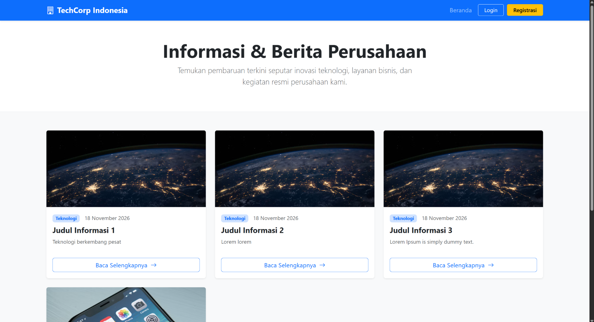
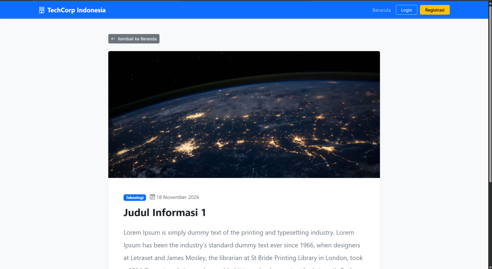
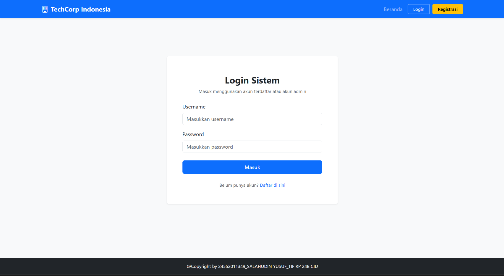
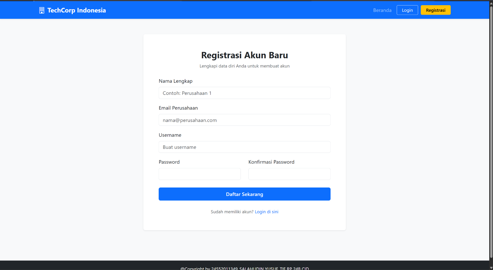
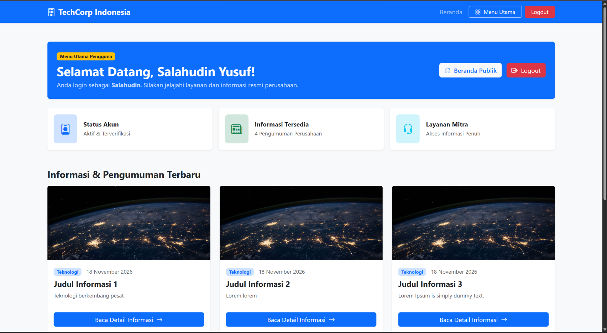
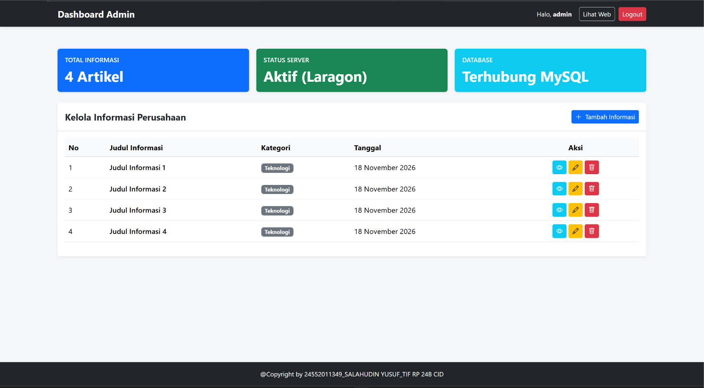
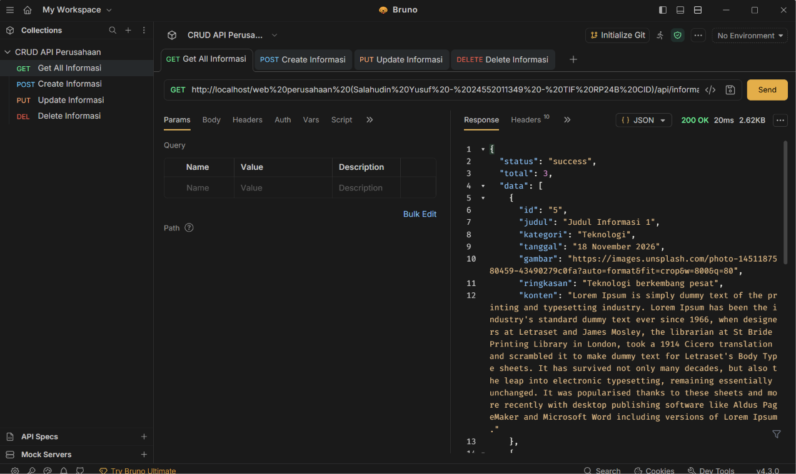
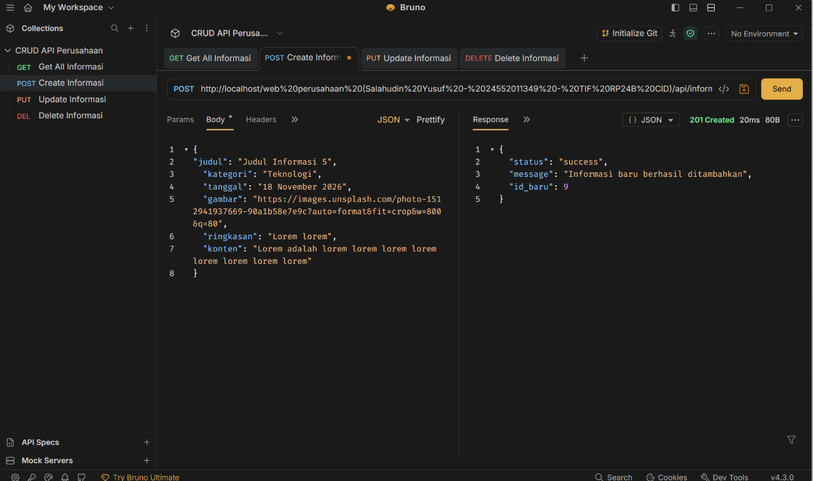
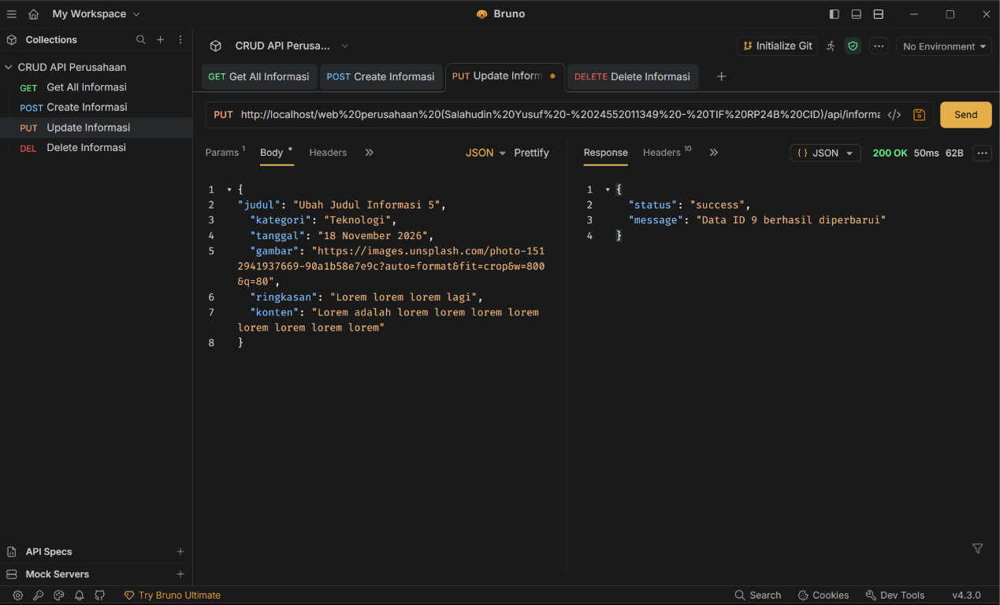
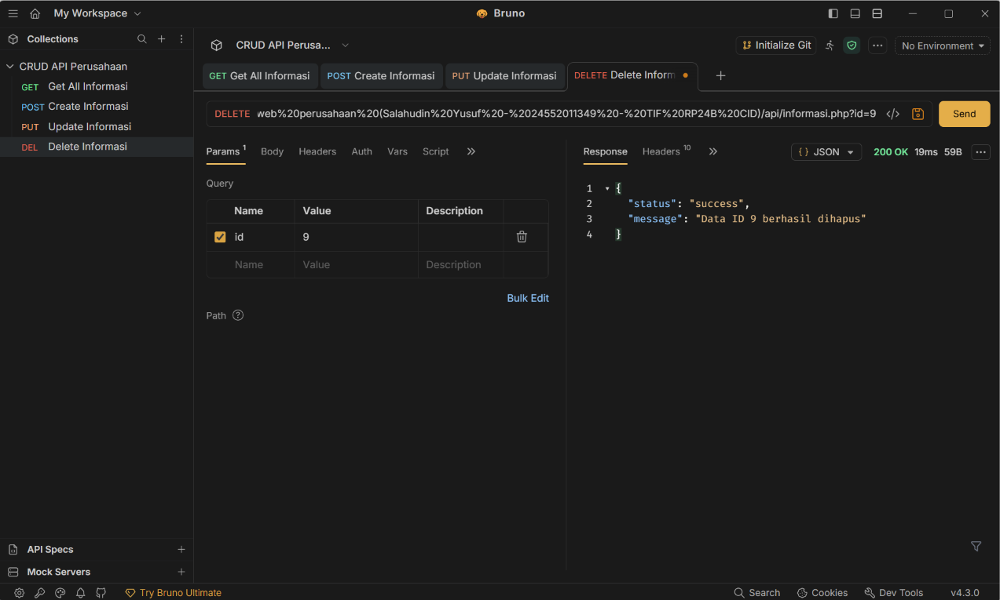

# Portal Informasi Perusahaan & CRUD REST API

Repository ini berisi gabungan **Project 1 (Frontend & Web Dinamis PHP + Bootstrap 5)** dan **Project 2 (Backend CRUD REST API)** yang terhubung dengan database MySQL.

- **Nama:** Salahudin Yusuf
- **NPM:** 24552011349
- **Kelas:** TIF RP 24B CID

---

## Struktur Folder
- `/api` : Endpoint REST API (`koneksi.php` & `informasi.php`) untuk operasi CRUD.
- `/includes` : Komponen modular (`header.php`, `footer.php`, `data_dummy.php`).
- `/screenshots` : Dokumentasi hasil tampilan web dan pengujian API menggunakan Bruno.
- `db_perusahaan.sql` : File struktur dan data awal database MySQL.

---

Akun admin
Username: admin
Password: 12345

## Dokumentasi Project 1 (Tampilan Website)

### 1. Halaman Utama (Beranda)

### 2. Halaman Detail Informasi

### 3. Halaman Login & Registrasi

### 4. Halaman Menu Utama & Dashboard Admin (CRUD)

---

## Dokumentasi Project 2 (Pengujian CRUD API dengan Bruno)

Endpoint utama: `http://localhost/web-perusahaan/api/informasi.php`

### 1. READ — Menampilkan Data (`GET`)

### 2. CREATE — Menambah Data Baru (`POST`)

### 3. UPDATE — Mengubah Data (`PUT`)

### 4. DELETE — Menghapus Data (`DELETE`)
